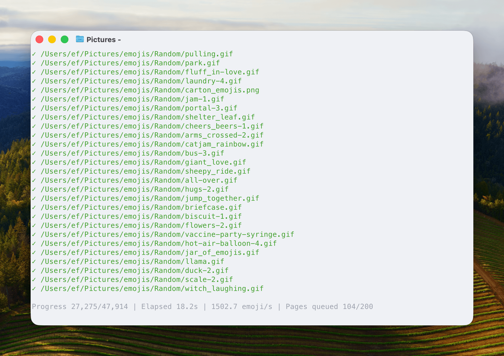

# slackmojis-dl

Downloads emojis from https://slackmojis.com/ using their official API



## Prerequisites

- Node.js 20.18.1 or later (Node.js 24 LTS recommended)
- npm

## Usage

```
npx slackmojis-dl
```

### Options

```
  --dest <path>                  Output root. Images go in <path>/emojis;
                                 dumps go in <path>/emojis.json.
                                 Defaults to the working directory.
  --category <name>              Filter downloads or dumps by category
  --limit <number>               Maximum number of pages; 0 makes no requests
  --page-concurrency <number>    Concurrent page requests
  --download-concurrency <number> Concurrent image downloads
  --dump                        Save the listing instead of downloading images
```

Limits must be non-negative integers. Concurrency values must be positive
integers. Without a limit, fetching continues to the end of the current listing;
bundled metadata does not cap a dump. `--page-concurrency` applies to both modes.
Run `npx slackmojis-dl --help` to see the supported category names.

### Examples

```
  $ npx slackmojis-dl --dest desired/path
  $ npx slackmojis-dl --limit=5
  $ npx slackmojis-dl --dest desired/path --dump
  $ npx slackmojis-dl --dest archive --dump --category "Meme"
  $ npx slackmojis-dl --category "Hangouts Blob"
  $ npx slackmojis-dl --page-concurrency 4 --download-concurrency 20
```

### Note

Emojis already found in the selected output's `emojis/` directory won't be
downloaded again on subsequent runs. Images are streamed to hidden temporary files
and published only when the transfer finishes. Failed transfers never overwrite
or delete an existing image. Temporary files left by a force-killed process are
ignored when resuming; they can be removed manually.

Atomic image publication requires a filesystem that supports hard links (for
example, ext4, APFS or NTFS). Unsupported filesystems fail instead of falling back
to an unsafe overwrite. Files truncated by older versions are not automatically
detected; remove those individual files to download them again.

Unsafe category names, filenames and unexpected image hosts are rejected rather
than rewritten. Images are fetched from `https://emojis.slackmojis.com`.

### Completion and cancellation

The CLI exits automatically after pending work finishes. Exit code `0` means
success; `1` means an argument, listing, filesystem or image-download failure,
including partial failures. Failed listings are not reported as "Up to Date".
Ctrl+C / SIGINT cancels requests and retry waits with exit code `130`; SIGTERM uses
`143`. Completed images remain available for the next run.

Dumps and resume metadata are replaced atomically, so an interrupted write does
not expose a partially written JSON file.

## Organization

```
emojis
|
|-- Cat Emojis
|    |
|    |-- angry_cat.png
|    |-- anguished_cat.png
|    ...
|
|-- Facebook Reaction
|    |
|    |-- fb-angry.gif
|    |-- fb-heart.gif
|    ...
|
|  ...
```

## Further Usage

These can then be uploaded to Slack manually or with an extension such as [Neutral Face Emoji Tools](https://chrome.google.com/webstore/detail/neutral-face-emoji-tools/anchoacphlfbdomdlomnbbfhcmcdmjej?hl=en) to drag-and-drop an entire folder.

## Development

```
npm ci
npm run lint
npm run build
npm test
npm run test:package
npm audit --audit-level=high
```

Tests use mocked HTTP responses and isolated temporary directories, including CLI
subprocess tests for exit codes and cancellation. CI runs these checks on Node.js
20, 22 and 24. No live Slackmojis downloads are required to run the tests. The
separate package smoke test requires npm registry access: it packs a clean source
copy with no existing build, installs the tarball with only production dependencies,
and checks the installed CLI's help, zero-limit download and dump commands.

## Publishing

Publishing is manual. Tags and GitHub releases do not publish to npm; the release
workflow was intentionally removed.

Run the development checks above, then choose a version that has not already been
published (`npm view slackmojis-dl version` shows the latest release). From a clean
working tree, with npm publishing access:

```sh
npm version <new-version>
npm publish --dry-run
npm publish --access public
```

`npm version` updates the manifest and lockfile and creates a commit and tag. Push
them and create the corresponding GitHub release after a successful publication.
Authenticate with `npm login` and complete any required two-factor authentication.
The dry run checks packaging, not account permissions or version availability.

Both `npm pack` and `npm publish` build the TypeScript through `prepack`, so the
package contains compiled JavaScript and bundled metadata without requiring build
tools on users' machines. Install development dependencies with `npm ci` first;
do not use `--ignore-scripts` when packing or publishing.
